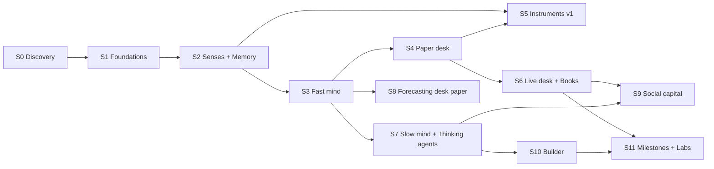

# 13 · Implementation plan

The complete build order for Asimog, from an empty repo to a self-funding, self-improving firm. Every task follows AGENTS.md: docs first, an E2E test that fails first, the smallest implementation, clean up. Every task ends with an artifact under `artifacts/e2e/<suite>/<run>/`.

Build **stages** (S0 to S11) are engineering order. Financial **milestones** (Start, M1 to M5, docs/22) are what the firm earns; some work only switches on when a milestone is reached.

## Status (2026-10-17, Windows)

| Stage | State | Evidence |
|---|---|---|
| S0 Discovery | Done | `docs/research/pumpfun-endpoints.md`; fixture `tests/e2e/fixtures/tapes/discovery-10m.ndjson.gz` recorded by the real readers |
| S1 Foundations | Done (Postgres 18, zod contracts, Tape, Clock, consumers, `ctl`). Moved to Windows: Postgres 18 in Docker (`npm run pg:start`), all 6 suites green in 88 s | `ctl doctor`, replays |
| S2 Senses and memory | S2.1 to S2.5, S2.8 done. S2.7 RPC trade backfill and S2.9 Scout built, not yet replayed. S2.6 X Reader open | Live runs: 0 errors, ~0.6 callouts/s, ~25 trades/s; firehose 232 trades/s (docs/research/pre-call-evidence.md) |
| S3 Fast mind | S3.1, S3.2 (age, echo, hawkes, callers, curve), S3.4 Reflex (`callout` pack, budget, queue), S3.5 Scorekeeper, S3.7 no-lookahead done. S3.8 callout tracking v2 (outcomes `ov2`, ledger, case files, hunt indicators, `caller.dna` lookahead fix) in this change. S3.10 flow and pre-call analyzers built, not yet replayed. S3.3 regime HMM, S3.6 attention, packs `coin`, `callers`, `guard` open | `analyzers-replay`, `callout-case-replay`; `precall-replay` written |
| S4 Paper desk | S4.1 to S4.8 done (DSL + validator, 30 seeds, fill model, Risk Gate, kernel, markouts, commit-reveal, evolution) | `strategies-replay`, `riskgate-refuses`, `commit-reveal`, `evolution-replay`, `replay-determinism` |
| S4.9 Pre-call desk | Built, not yet replayed: entries on a known caller's buy, `called_s_gte` exit, `pre_call` seeds | `precall-replay` written |
| S6.0 Thesis and paper Publisher | Built, not yet replayed: thesis, commit, house callouts and updates as PAPER posts, house row in the caller ledger | `precall-replay` written |
| S2.10, S3.11, S3.12, S4.10, S6.0b Index and evolving strategy (docs/23) | Built and smoke-run live (3 minutes, paper): Index rollups, copy scores, `risk.state`, `wallets.smart_buying`, rug and bundle floor in the Risk Gate, evolving thresholds, `smart_early` and `launch_scan` families, paper data replies. Replays not run (owner: suites at milestones) | Live smoke 2026-10-17: 40k firehose trades, ~120 promotions, 2,048 intents, 254 paper fills, 0 errors |
| S5 Instruments v1 | **Built, all rooms dark and uniform (owner, 2026-10-17).** Field v2 after the inspiration audit (docs/inspiration): fibrous clouds in two regions (on the curve, graduated to PumpSwap), strand bundles between coins that share callers, Core filaments to held coins, packets for every real trade, fill, post and caller move, a glow pass, callout boxes with leader lines, region captions, legend; HUD and strip. Cortex (brain, lobes lit per lane), Lab (commit arc, reveal rays, evidence threads per coin, theses), Ledger, Integrity (caller ledger with denominators, copyable wallets, risk floor), Charter, legal pages. Relay: room endpoints, caller links, graduated coins. **Added 2026-10-18:** Treasury (PAPER balance, reconciliation, Tape proof chain verified in the browser), Rewind (`/rewind`, Board at T), Connectome (static SIMULATED stand-in until `fly.action` exists; S11.3 proper stays open), case files (`/case/[id]`), share cards (`/cards/[id]`, `next/og`), and the suites `site-shell`, `site-field`, `site-cortex`, `site-lab`, `site-integrity`, `site-treasury`, `site-rewind`, `site-cards` (all pass). Open: deploy (S5.9), live-stream motion checks (video-frames), phone frame-time budget | `apps/web`, `npm run relay`, `npm run web`; `npm run e2e site-shell site-field site-cortex site-lab site-integrity site-treasury site-rewind site-cards` (needs relay, web and Postgres running) |
| S6.1 to S6.7 Signer, Trader, Books, sweep, proofs, kill | **Built and tested on a mocked chain (2026-10-18).** `services/signer`, `hands/{trader,order-gate,builder,chain}.ts`, `treasury/{books,sweep,proofs,kill,wire}.ts`. Suites `signer-refuses`, `books-reconcile`, `sweep`, `kill` pass; `live-roundtrip` is skipped until the owner supplies keys. Not done: fill-drift kill trigger (needs live fills), the hourly list-and-close of open empty token accounts, measured-cost runway (env `AGENT_RUNWAY_SOL` for now), S6.3 Publisher live mode. S6.8 (go live) is untouched | `e2e/signer-refuses`, `books-reconcile`, `sweep`, `kill` |
| S6.8 to S11 | Open | |

**Order now (owner, 2026-10-17).** 1. S5 UI and UX: done to v2 (dark, uniform, network motion); next are Treasury, Rewind and deploy. 2. Deferred: RPC pool tests with several providers, long Index runs (smart wallets), replay suites and recorded tapes; they wait for the next milestone run. 3. Then S6 (live desk), S7 (BettaFish, MiroShark).

**Why the pre-call work jumped the queue.** Buying after a callout loses money (54 of 61 measured callouts lost at 5 min after costs). Callers must hold a coin to call it, and on the fixture the author's own buy came a median 57 s before the callout, with a median 3-minute peak 1.30x above that buy (docs/research/pre-call-evidence.md). The desk now reads callers' buys before their callouts, forms its own thesis and posts its own (paper) callouts. Replays of these suites wait for a longer tape and the next milestone run (owner's call, 2026-10-17).

Measured, not yet at target: Reflex p95 is 400 to 600 ms from the dev machine (target 200 ms, S3.4).

## What the owner provides

| Item | Used by | Needed at |
|---|---|---|
| W_trade keypair with 0.2 SOL | Signer | S6 |
| W_creator keypair of the given coin | Signer | S6 |
| W_agent keypair and W_operator public key | Signer, Treasurer | S6 |
| Helius free-tier API key | Chain Reader, Trader | S2 |
| TypeSafe (Jev) API key | Reflex | S3 |
| OpenRouter keys, one per lane, each with a spend limit | Thinking agents, BettaFish, MiroShark, Builder | S7 |
| X account for the agent (credentials for XActions) | X Reader, social | S2 read, S9 post |
| GitHub access to `asimog/asimov` and a bot token for the Builder | Builder | S10 |
| Host: Coolify machine with a Cloudflare Tunnel, or Railway; DNS for asimog.com | Deploy | S5 |

## Dependency map

Critical path to live trading: S0 → S1 → S2 → S3 → S4 → S6. S5, S7 and S8 run in parallel once their inputs exist.

## S0 · Discovery (minutes at agent speed)

| ID | Task | Depends | Output | Done when |
|---|---|---|---|---|
| S0.1 | Finish installs in `services/core`: `pnpm approve-builds` (agent-browser, bigint-buffer, bufferutil, utf-8-validate); `pnpm exec agent-browser install` | - | Working agent-browser and Chrome | `agent-browser --version` prints |
| S0.2 | HAR capture of `/callouts`, 5 threads, 5 profiles, 3 coin pages with `?highlight_callout` (docs/06) | S0.1 | `docs/research/pumpfun-endpoints.md` | Every read endpoint listed with a sample payload |
| S0.3 | Inspect NATS WebSocket frames: connect options, subjects, any callout subjects | S0.1 | Section in the research doc | Trade subject confirmed with a live sample |
| S0.4 | Posting flow capture: log in session S8 with W_trade and record one manual callout and one update on a coin it holds (owner presses submit) | S0.1 | Posting payloads, holding threshold, cooldowns | Values written in the research doc |
| S0.5 | Record a 10-minute raw tape with a throwaway script (observations only) | S0.2, S0.3 | `tests/e2e/fixtures/tapes/discovery-10m.ndjson.gz` | File exists; throwaway script deleted |

## S1 · Foundations (minutes at agent speed)

| ID | Task | Depends | Output | Done when |
|---|---|---|---|---|
| S1.1 | Root tooling: Biome, ruff, base `tsconfig`, `.env.example`, `deploy/compose.yaml` (Postgres 17, Neo4j, MinIO) | S0 | Root config | `docker compose up` healthy; `pnpm lint` passes |
| S1.2 | `packages/contracts`: JSON Schemas for the envelope, topics (docs/04), signals, intents, orders; `pnpm gen` to TS and Python | S1.1 | Generated types | CI fails if generated files differ from the schemas |
| S1.3 | Providers chosen by env inside core (`lib/rpc.ts` RpcPool, Jev in `reflex/`, LLM via OpenRouter base URL); no separate package until a second process needs them | S1.1 | Provider package | `ctl doctor` lists each provider and reaches it |
| S1.4 | Clock (live, paper, replay), seeded RNG, prefixed ULID helper | S1.2 | `services/core/src/clock` | Same seed and tape give the same IDs |
| S1.5 | Tape: `tape.events` with monthly partitions, writer role, batched inserts, `NOTIFY`, consumer offsets, idempotent consumer base | S1.4 | `services/core/src/tape` | 100k events replayed with no duplicates after a forced restart |
| S1.6 | Object storage for blobs (observations, HAR, frames) | S1.3 | Blob helper | Observations cite blob keys and sha256 |
| S1.7 | `ctl` CLI skeleton: `state`, `tail`, `why`, `replay --report`, `doctor`, `pause`, `kill` | S1.5 | CLI | Commands print JSON |
| S1.8 | E2E harness: replay driver, artifact writer, `pnpm e2e` | S1.5 | `tests/e2e/lib` | `e2e/replay-determinism` passes twice with the same hash |
| S1.9 | CI: lint, typecheck, gen check, replay suites | S1.8 | GitHub Actions | Green on main |

## S2 · Senses and memory (minutes at agent speed)

| ID | Task | Depends | Output | Done when |
|---|---|---|---|---|
| S2.1 | Feed Reader: endpoints from S0.2, cursor walk, dedupe, gap detection, 48 h backfill | S1.5 | `callout.*` events | `e2e/gap-heal`: a 2-minute outage heals with zero missing callouts |
| S2.2 | Chain Reader: NATS trades for the watched set; RPC websocket `accountSubscribe` for curve state; `signatureSubscribe` for our wallets | S1.3, S1.5 | `trade.*`, `curve.state` | `e2e/live-capture-30m` replays to identical projections |
| S2.3 | Sessions service: agent-browser sessions (count from `SESSIONS`), reading protocol, extractors for feed, thread, profile and coin page | S1.5, S0.2 | `session.*`, extracted facts | `e2e/session-crash`: a killed Chrome returns within 15 s |
| S2.4 | Frame capture: per-session stream, change detection, 2 fps cap, minute snapshots to storage | S2.3 | Frames with read boxes | Frames arrive with boxes matching the read elements |
| S2.5 | Memory projections: coins, callers, callouts, edges, bars_1m, wallets | S2.1, S2.2 | `mem.*` | Rebuilding from the tape gives identical table hashes |
| S2.6 | X Reader (read only): posts and profiles linked from callouts, screenshots | S2.3 | `x.post` | `e2e/x-proof` stores a post with its screenshot |
| S2.7 | RPC trade backfill (`senses/backfill.ts`): when a coin enters the watched set (callout, Scout promotion) or a `trades` gap closes, fetch its bonding curve's recent signatures (`RPC_BACKFILL_SIGS`, budgeted by `RPC_BACKFILL_RPS` and `RPC_BACKFILL_TX_PER_HOUR`), decode pump `TradeEvent` from `Program data:` logs with the SDK decoder, and write `trade.curve` with source `rpc`, `event_time` = block time, dedupe `trade:<sig>:rpc:<i>`, skipping signatures the Tape already holds. The Scorekeeper orders `rpc` trades by `event_time`, so a backfilled pre-call trade becomes an entry once it is known. Pattern: `myron-dev/pump-indexer` | S2.2, S2.8 | Pre-call and gap trades | `e2e/backfill-replay`: a recorded backfill turns `no_entry` outcomes into real ones; `pre_call_trades` > 0 for most called coins; `ctl coverage` shows NATS vs. RPC overlap |
| S2.9 | Scout (`senses/scout.ts`): one in-memory pass over the whole firehose `unifiedTradeEvent.lite.>`. It keeps the known caller wallets (`mem.callers`, refreshed every `SCOUT_CALLERS_REFRESH_S`) and per-coin rolling flow. It promotes a coin into the watched set with `coin.watched` when a known caller buys it (`reason: caller_buy`, the triggering trade written to the Tape) or its flow heats (`reason: heat`, `SCOUT_HEAT_BUYERS` unique buyers and `SCOUT_HEAT_NET_SOL` net inflow in 60 s). Writes nothing else for unwatched coins | S2.2 | `coin.watched`, trigger trades | `e2e/precall-replay`: recorded `coin.watched` events promote coins and drive pre-call signals |
| S2.10 | Index (docs/23): Scout rollups into `idx.wallet_coin`; callout backfill to 30 days; seed lists from pnl-leaderboard, mint-positions and top-trader trades; launches and graduations from NATS lifecycle; per-candidate RPC reads through the pool; versioned refresh with `index.refreshed` | S2.9, S2.7 | `idx.*`, `index.refreshed` | `e2e/index-replay`: rollups rebuild identically from a recorded tape; no score version reads data seen after it; coverage report lists every source |
| S2.8 | Coverage: senses write `system.gap` (feed walk exhausted, NATS disconnects, coins dropped from the watched set); `ctl coverage` | S2.1, S2.2 | `system.gap`, coverage report | `e2e/callout-case-replay`: an injected gap marks overlapping outcomes `gap` and the ledger counts them as excluded |

## S3 · Fast mind (minutes at agent speed)

| ID | Task | Depends | Output | Done when |
|---|---|---|---|---|
| S3.1 | Board: `signals`, live view, in-memory mirror, expiry | S1.5 | `board.*` | Expired signals are absent to readers |
| S3.2 | Cheap analyzers: age, echo, hawkes, curve (pump-sdk math), integrity patterns v0 | S2.5, S3.1 | Signals per docs/07 | `e2e/analyzers-replay` report with counts and scores |
| S3.3 | analyzers-py: regime HMM with tremor, Tier 1 caller models, nightly fits | S2.5, S3.1 | `regime.*`, `callers.*` | Fits run on the fixture; posteriors emitted |
| S3.4 | Reflex: Jev packs `callout`, `coin`, `callers`, `guard` (docs/17), bucketed states, `jev.answer` recorded, pinned model, budget meter | S3.2 | `jev.*` signals | `e2e/reflex-live`: p95 pack latency ≤ 200 ms; replays make zero Jev calls |
| S3.5 | Scorekeeper: outcomes at 1, 3 and 5 min (compressed); Brier for probability signals | S3.2 | `outcome.*`, `score.*` | Scores appear in the analyzers report |
| S3.6 | Attention v0 and the escalation gate | S3.4 | `attention.grant`, `jev.escalated` | Escalations happen only when the gate rules fire |
| S3.7 | No-lookahead check in every replay | S3.2 | Replay check | `e2e/no-lookahead` reports zero violations |
| S3.8 | Callout tracking v2 (docs/07): outcomes `ov2` (entry basis, peak, trough, time to peak, net multiple at our size through the fill model, phase, coverage, corrections by supersede); caller ledger `cl1`; case files with evidence classes (docs/03); hunt indicators `wash_atomic`, `bundle_buy`, `author_trades`, `ticker_collision`, `no_pump_suffix`, `thin_curve`; `caller.dna` from our own resolved outcomes | S3.5, S2.8 | `ctl case`, `ctl callers`, `ctl coverage` | `e2e/callout-case-replay`: a losing call's case file is written as an artifact and rebuilds byte-identical; the ledger's denominators add up; duplicate ingest and a consumer restart change nothing |
| S3.9 | Baselines from the literature (docs/research/literature-review.md): graduation probability given curve progress vs. the breakeven `vSol² / 115²`; creator launches in the prior 60 min and metadata host as cheap features (Chrisymcsoup); fastest accumulation (trades to reach a level) | S3.8, longer tapes | `baseline.*` rows in the analyzers report | Numbers computed on our tapes, with coverage, never copied from papers |
| S3.10 | Flow and pre-call analyzers (docs/07 `flow`, `precall`): `flow.state` per traded coin (60 s buyers, net SOL, acceleration, top-buyer share, tracked callers buying); `precall.callout_p` on a known caller's buy (P(a callout on the coin within `PRECALL_HORIZON_MIN`), per-caller Beta posterior over our own record of their buys and calls, combined over tracked callers buying); the Scorekeeper scores it with Brier | S3.8, S2.9 | `flow.state`, `precall.callout_p`, `score.updated` | `e2e/precall-replay`: signals on every known-caller buy, none after the horizon is known; Brier rows for `precall.callout_p` |
| S3.11 | Copy scores and archetypes (docs/23 2.3): copied trades through the fill model with our latency; `copy_net`, `copy_win_lcb`, `early_right`, `lead_s`, half-life decay; archetypes by rule; signals `wallets.smart_buying`, `wallets.lead` | S2.10 | `wallets.*` | Scores computed on the Corpus tape and our tape; snipers never `smart` |
| S3.12 | Rug and bundle signals (docs/23 3): `risk.bundle`, `risk.fresh`, `risk.dev`, `risk.concentration`, `risk.snipers`; RPC confirmation for candidates; Risk Gate floor from the owner's limits | S2.10 | `risk.*`, new reason codes | `e2e/riskgate-refuses` covers each new floor |

## S4 · Paper desk (minutes at agent speed)

| ID | Task | Depends | Output | Done when |
|---|---|---|---|---|
| S4.1 | Strategy DSL interpreter and validator (docs/08), including the fast-horizon rule and the cost-floor term | S3.1 | `mind/strategies` | Invalid specs are rejected with reasons |
| S4.2 | Seed Strategy Pool: 5 families × 6 variants | S4.1 | Seed specs | All load and evaluate on the fixture |
| S4.3 | Fill model: curve quote, latency, slippage, pump fees, account rent and its refund on close | S3.2 | `mind/fill` | Ghost fills match curve math within 1 lamport |
| S4.4 | Risk Gate: pure function, reason codes, limits from config sized for 0.2 SOL | S4.1 | `mind/risk` | `e2e/riskgate-refuses`: every listed bad intent refused |
| S4.5 | Kernel at desk level: Thompson sampling with LCB, probe stage | S4.3 | `mind/kernel` | Allocation report per round |
| S4.6 | Paper markouts and paper ledger | S4.3 | `markout.measured` (paper) | Every ghost fill has markouts |
| S4.7 | Commit-reveal: hash hypotheses, forecasts and decisions; reveal on resolution | S1.5 | `commit.*` | `e2e/commit-reveal`: 100 reveals match their hashes |
| S4.8 | Evolution loop: mutation, crossover, niches, retirement | S4.5 | `strategy.*` | `e2e/evolution-replay`: births and retirements, no duplicates |
| S4.9 | Pre-call desk: a coin is in play after a callout or after a known caller's buy (`ENTRY_WINDOW_MIN`); `called_s_gte` exit (seconds since a callout landed on a coin we already hold); seed family `pre_call` (6 variants) | S3.10 | Pre-call ghost trades | `e2e/precall-replay`: pre-call entries happen only before a callout from that caller and exit into it |
| S4.10 | Evolving thresholds and `smart_early` (docs/23 4): mutation nudges universe thresholds within bounds; `risk.*` and `wallets.*` in the DSL catalog; the `smart_early` seed family | S3.11, S3.12 | Strategies on Index signals | Replay on the Corpus with a realistic fill delay beats the cross-6K baseline net of costs, or the family is reported as failing |

## S5 · Instruments v1 (minutes at agent speed, parallel with S4 and S6)

| ID | Task | Depends | Output | Done when |
|---|---|---|---|---|
| S5.1 | Relay service: SSE fan-out, frame WebSocket, cached read endpoints | S2.4, S1.5 | `services/relay` | 500 simulated viewers with no load on core |
| S5.2 | Web shell: Next.js app, tokens (docs/12), fonts, footer, HUD with real numbers, skeletons | S5.1 | `apps/web` | `e2e/site-shell` screenshots at desktop and phone |
| S5.3 | Field prototype on a phone first: 40k-point clouds, layout worker, temperature uniform | S5.2 | Field scene | p95 frame time within budget on a mid-range Android |
| S5.4 | Field complete: 200k points on desktop, filaments, labels, session thumbnail atlas, strip panels | S5.3, S4 | Field | `e2e/site-field`: every visible change maps to a tape event. Built as a cue check (2026-10-18): every motion cue the scene draws carries the id of the event that caused it, and the suite finds each id on the Tape. The video-frames check is still open |
| S5.5 | Cortex: procedural brain, lobe lighting, slices, strip | S5.2 | Cortex | `e2e/site-cortex` |
| S5.6 | Lab: arc with committed cards, threads, rays, counters | S4.7, S5.2 | Lab | `e2e/site-lab` |
| S5.7 | Ledger, Charter (constitution, soul timeline, disclosure registry), Treasury (proof chain) | S5.2 | Pages | Numbers on screen equal API values |
| S5.10 | Integrity room v1: case files rendered with the six evidence sections (docs/07), each section visually distinct; the caller ledger with denominators and exclusions | S3.8, S5.2 | `/integrity`, `/case/[id]` | `e2e/site-integrity`: the page text for a fixture case equals the `ctl case` JSON; no section mixes classes |
| S5.8 | Share cards with `next/og` | S5.2 | `/cards/[id]` | Card images render for 20 sample calls |
| S5.9 | Deploy asimog.com on the chosen profile | S5.2 | Live site | Site reachable; the Signer unreachable from outside |

## S6 · Live desk and books (minutes at agent speed)

| ID | Task | Depends | Output | Done when |
|---|---|---|---|---|
| S6.0 | Thesis and paper Publisher (`hands/publisher.ts`, docs/09): on the first ghost buy of a calling strategy on a coin, form a thesis (claims by evidence class, a prediction, a plan, invalidation), commit it, render the terse callout, run the text checks, write `thesis.formed` and `post.queued` (PAPER). Exits and the close become updates; the close reveals the thesis. The Scorekeeper scores house callouts as author `house`, so `ctl callers` puts the house next to every other caller | S4.9, S4.7 | House callouts on paper | `e2e/precall-replay`: every house callout has a commit made before it and a reveal after it; every text passes the checks; the house row has denominators |
| S6.0b | Data replies on paper (docs/23 5): drafts on callouts whose coin breaches the risk floor; integrity threshold, Guard, text checks; scored at 24 h | S3.12, S6.0 | `post.queued` kind reply, paper | Every reply passes the checks; reply rules scored |
| S6.1 | Signer: allowlisted endpoints, capability tokens, audit log, no public route | S1.3 | `services/signer` | `e2e/signer-refuses`: every forbidden request refused and logged |
| S6.2 | Trader: fun-block swap, simulate before send, confirm, parse real fills, idempotency by order id, **close the token account after every full exit** | S6.1, S4.4 | `hands/trader` | `e2e/live-roundtrip` (0.01 SOL): buy, sell, account closed, rent back |
| S6.3 | Publisher: S8 login shim, eligibility checks, callout and update templates, Guard on every post, cooldown batching | S6.2, S3.4 | `hands/publisher` | `e2e/publisher-post`: a callout and an update visible on Pump.fun |
| S6.4 | Books: double-entry ledger projection, hourly reconciliation, NAV, cost attribution | S6.2 | `treasury/books` | `e2e/books-reconcile`: a recorded day reconciles to the lamport |
| S6.5 | Fee sweep every 10 minutes with the split (docs/10) | S6.1, S6.4 | `treasury/sweep` | `e2e/sweep`: three sweeps match chain amounts |
| S6.6 | Hourly proofs and on-chain memo | S6.4, S4.7 | Proof chain | Anyone can verify the chain from `/treasury`: each `books.proofs` segment is recomputed in the browser (sha256 of the canonical body, linked by `prev_sha256`) and can be downloaded; the memo signature links to the explorer in `NEXT_PUBLIC_EXPLORER_TX_URL` |
| S6.7 | Kill switch and automatic kill triggers | S6.2 | `ctl kill` | `e2e/kill`: orders stop, senses keep recording |
| S6.8 | **Go live**: 0.02 SOL trades, max 5 open, callouts on | S6.1 to S6.7 | Live desk | First 20 live trades with markouts on the Ledger |

## S7 · Slow mind and thinking agents (minutes at agent speed, parallel)

| ID | Task | Depends | Output | Done when |
|---|---|---|---|---|
| S7.1 | **Thin slice only (2026-10-18), not the fork the plan asked for.** A 210-line TypeScript feed synthesis: presets by env, forum lines, a word-overlap claim check (not Jev verify), word-list mood; no Insight reflection loop, no Query or Media engine, coin runs not triggered. Owner wants the full build for our use case; fork-vs-port is the open decision (docs/16). Every claim cites an existing callout | S2.5, S3.4 | `services/bettafish` | `e2e/synthesis-run`: every claim cites an existing callout |
| S7.2 | **Thin slice only (2026-10-18), not the fork the plan asked for.** A 280-line TypeScript swarm: the AMM port is complete and SDK-tested; personas are caller stats plus fixed follower types; no platform tables, belief state, graph memory or report agent; runs are manual (no escalation trigger). Full build pending (docs/16) | S3.2 | `services/miroshark` | `e2e/amm-golden` and `e2e/swarm-run` |
| S7.3 | **Built.** MCP server in core with capability-filtered tools | S1.7 | `core/mcp` | The tool list differs per token |
| S7.4 | **Built.** `services/agents`: LangGraph JS runtime, Postgres checkpoints, job table, OpenRouter per-lane keys | S7.3 | Agents runtime | A no-op agent runs on schedule |
| S7.5 | **Built (stub LLM; real runs wait for lane keys).** Agents: Postmortem, Question Researcher, Ops, Reporter, Integrity writer (docs/18) | S7.4 | Five graphs | `e2e/agent-lanes`: out-of-lane tools refused |
| S7.6 | **Built.** `soul.update` with validation, versions and a hash chain | S7.4 | Soul versions | The version shows on `/charter` |

## S8 · Forecasting desk on paper (minutes at agent speed, parallel)

| ID | Task | Depends | Output | Done when |
|---|---|---|---|---|
| S8.1 | `polymarket.read` and `kalshi.read` adapters: markets, prices, resolutions | S1.3 | Forecast adapters | Markets ingested as events |
| S8.2 | Forecast pack in Jev, with LLM research escalation, for crypto and BTC and ETH questions | S3.4, S8.1 | `forecast.*` signals | Forecasts committed before resolution |
| S8.3 | Forecast ledger and Brier score versus the market price | S8.2, S4.7 | Public record | `e2e/forecast-paper`: 50 forecasts scored |
| S8.4 | Lab strip: calibration curve, forecast cards on the arc | S8.3, S5.6 | UI | Shown on `/lab` |

## S9 · Social capital (minutes at agent speed)

| ID | Task | Depends | Output | Done when |
|---|---|---|---|---|
| S9.1 | Social ledger: followers, engagement, visitors, bounty participants (docs/22) | S2.1, S2.6 | `social.*` | A daily social balance is computed |
| S9.2 | X posting adapter: rate-limited, Guard-checked, terse voice | S6.3 | `social.x.post` | Posts appear; every post has a why-chain |
| S9.3 | Bounty adapter: tasks posted on X and as GitHub issues, submissions read, payouts from W_agent, public results | S9.1, S6.1 | `bounty.*` | `e2e/bounty-cycle`: post, receive, pay, publish |
| S9.4 | Kernel at social level: campaigns as positions measured by social return per SOL | S9.1, S4.5 | Social allocations | The allocation report includes social positions |
| S9.5 | Daily Report on `/reports` and X | S7.5, S9.2 | Reports | One report per day |
| S9.6 | Self-hosted analytics (Umami) | S5.9 | Visitor counts | Numbers feed the social ledger |

## S10 · Builder (minutes at agent speed)

| ID | Task | Depends | Output | Done when |
|---|---|---|---|---|
| S10.1 | Sandbox runner: disposable container per task with a git checkout and toolchain, no keys, no production network | S1.1 | Sandbox | A task runs `pnpm e2e` inside it |
| S10.2 | Builder graph: task → plan → code (coding model via OpenRouter) → run suites → open a PR with artifacts | S7.4, S10.1 | Builder agent | `e2e/builder-task`: a small task becomes a passing PR |
| S10.3 | Protected-file guard: the Builder cannot touch the constitution, the Signer, the books or the milestone checks | S10.2 | Guard | A PR touching them is refused before it opens |
| S10.4 | First project: re-implement cancerhawk.org from scratch in a new repo, then improve it | S10.2 | New repo and site | Owner review; the Lab shows the build history |
| S10.5 | Auto-merge path after M2: suites pass plus 24 h notice on the Lab | S10.3, S11.1 | Policy | The owner switches it on |

## S11 · Milestones and labs (minutes at agent speed)

| ID | Task | Depends | Output | Done when |
|---|---|---|---|---|
| S11.1 | Milestone engine: NAV and runway checks, the health condition, unlocks and demotion (docs/22) | S6.4 | `milestone.*` | `e2e/milestone-demote`: a reconciliation mismatch drops one milestone |
| S11.2 | Integrity board and data replies (docs/07) | S3.2, S6.3 | `/integrity` | Findings with evidence |
| S11.3 | Connectome Lab (wetware, 1% sleeve) | S4.5 | `/connectome` | The fly trades on paper, then live at 1% |
| S11.4 | Rewind | S5.4 | `/rewind` | The Board at time T equals what was live at T. **Built 2026-10-18; `e2e/site-rewind` passes** |

## Unlocked by milestones later

| Milestone | Work it unlocks |
|---|---|
| M3 (10 SOL) | Live forecasting adapters; the agent builds the polymyths.com frontend |
| M4 (100 SOL) | BTC and ETH desk through ccxt or prediction markets; the agent builds the hyperkaon.com frontend; it buys its own compute |
| M5 (1,000 SOL) | Holder payouts and seats (docs/10) |

## Dependencies to install, by stage

| Stage | TypeScript | Python |
|---|---|---|
| S1 | `@biomejs/biome`, `json-schema-to-typescript`, `ajv`, `postgres`, `ulid`, `hono`, `tsx` | `datamodel-code-generator`, `psycopg`, `ruff` |
| S2 | `nats.ws`, `@aws-sdk/client-s3` | - |
| S3 | - | `numpy`, `scipy`, `hmmlearn`, `scikit-learn`, `typesafe-sdk` |
| S5 | `next`, `react`, `three`, `@react-three/fiber`, `@react-three/drei`, `@react-three/postprocessing`, `zustand`, react-bits and tweenly items | - |
| S7 | `@langchain/core`, `@langchain/openai` (lane models, `packages/lane`), `@langchain/langgraph`, `@langchain/langgraph-checkpoint-postgres`, `@langchain/mcp-adapters` (`services/agents`), `@modelcontextprotocol/sdk` (core MCP server and clients) | None for now: BettaFish and MiroShark are rebuilt in TypeScript (docs/07 "Build choice") |
| S8 | - | `catboost` (question bank) |
| S11 | - | `wetware` (pinned git commit) |

Already installed in `services/core`: the four `@pump-fun` packages, `@solana/web3.js`, `bn.js`, `agent-browser`, `xactions`, `@typesafe-ai/sdk`.

## The first weekend

| Day | Stages | End state |
|---|---|---|
| Friday evening | S0 | Endpoint catalog, posting payloads, a 10-minute tape |
| Saturday | S1, S2 | Tape, CLI, replay harness, Feed Reader, Chain Reader, sessions, memory |
| Sunday | S3, S4.1 to S4.4, S5.1 to S5.3 | Analyzers and Jev live on real data; paper strategies; the Field prototype on a phone |

## Definition of done for the whole plan

1. All E2E suites in this doc pass in CI with stable hashes.
2. The desk trades live at 0.02 SOL with callouts and posted exits, and the books reconcile every hour.
3. The forecasting desk has 200 resolved paper forecasts with a public Brier score.
4. The Builder has shipped at least one merged PR and the cancerhawk.org rebuild.
5. The site shows the Field, Cortex, Lab, Ledger, Treasury and Charter with live data.
