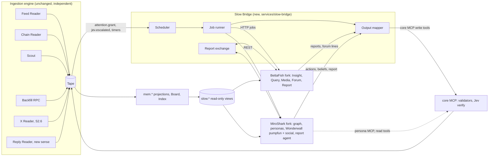

# 24 · Slow mind integration: full BettaFish and MiroShark

Status: **building, 2026-10-18.** Owner decision: the engines live **inside this repo** (`services/bettafish/engine`, `services/miroshark/engine`, vendored from upstream with an `UPSTREAM` file naming the commit), not as forks or submodules. Licences checked by the owner; credits to be added. Stack: `docker-compose.yml` (Postgres + Neo4j as the data stack, one persistent `slow-workers` container for both engines); `npm run stack:data`, `npm run stack:up`.

Original status: plan, 2026-10-18. It replaces the thin TypeScript slices in `services/bettafish` and `services/miroshark` (about 210 and 280 lines) with the real upstream engines, forked and configured for Pump.fun callout intelligence. Nothing in the engines is cut to make them fit. The callout ingestion engine stays as it is, separate and independent, and feeds both engines at the same time. The two engines can also read each other's reports.

Read with: docs/03 (Tape, Board, consumers), docs/07 (the BettaFish and MiroShark contracts and knobs), docs/17 (Jev `verify`, escalation), docs/18 (lanes, MCP, capability tokens), docs/15 (cost), docs/16 (the fork-or-port decision this plan answers).

Terms used once here:

- **Fork:** our own copy of the upstream repo on GitHub, kept as a git submodule, with our changes on a branch named `agent`.
- **Adapter:** code that lets one part talk to another without either changing its shape.
- **Bridge:** the one new service in this plan. It is the adapter between our core and both engines.
- **Seed:** the starting material a MiroShark simulation is built from (documents, a knowledge graph, personas).
- **IR:** BettaFish's structured report format (JSON with fixed blocks), before it is turned into HTML or Markdown.

---

## 1. What the upstream repos are (read from source, 2026-10-18)

Both repos were read from source in `.upstream/repos/` (`666ghj__BettaFish` at `b67928f`, `MiroShark__MiroShark` at `621e07f`, and the older `666ghj__MiroFish`). The reverse-engineering skill (REA) is meant for shipped binaries and packaged apps. We have the full source, so reading it directly is the accurate path. REA becomes useful only if we later need to compare against the hosted MiroShark site.

### 1.1 BettaFish (about 57k lines of Python, GPL-2.0)

| Part | Where | What it does | How it couples to the rest |
|---|---|---|---|
| Insight engine | `InsightEngine/agent.py` (`DeepSearchAgent`), `nodes/`, `tools/search.py` (`MediaCrawlerDB`), `tools/sentiment_analyzer.py` | Plans a report outline (`MAX_PARAGRAPHS`, default 6). For each paragraph: first search, first summary, then a reflection loop (`MAX_REFLECTIONS`, default 3) that searches again and rewrites. Search tools query a crawled-posts database: `search_hot_content` (hotness formula per platform table), `search_topic_globally`, `search_topic_by_date`, `get_comments_for_topic`, `search_topic_on_platform`. Results are clustered and sampled, then run through a multilingual sentiment model (`tabularisai/multilingual-sentiment-analysis`). | Reads the database through `utils/db.py` (MySQL or Postgres dialect). Reads the forum host's latest speech through `utils/forum_reader.py` and puts it into its summary prompt. Writes a Markdown report and a state JSON to its own folder, and logs every node's output. |
| Query engine | `QueryEngine/` | Same plan, search, summary and reflection loop, over news search (`TavilyNewsAgency`: basic, deep, last 24 h, last week, by date, images). | Same files and logs pattern. Needs `TAVILY_API_KEY`. |
| Media engine | `MediaEngine/` | Same loop over multimodal web search (`BochaMultimodalSearch`, `AnspireAISearch`: web pages, images, structured cards). | Same pattern. Needs a Bocha or Anspire key. |
| Forum engine | `ForumEngine/monitor.py` (`LogMonitor`), `ForumEngine/llm_host.py` (`ForumHost`) | Tails the three engines' log files, extracts each node's JSON output, writes it to `logs/forum.log`, and every N agent speeches asks an LLM "host" to summarise and steer. The engines read the host's speech back. | Couples only through log files. This is the debate that makes BettaFish more than three separate searches. |
| Report engine | `ReportEngine/agent.py` (`ReportAgent`), `nodes/` (template selection, document layout, word budget, chapter generation), `ir/schema.py`, `renderers/` (HTML, PDF, Markdown, chart to SVG), `report_template/` | Takes the three engines' reports plus the forum log. Picks a template, plans a layout and a word budget, writes chapters as IR blocks, validates and repairs them, then renders them. It has rescue LLMs and retries. | Reads the newest file in each engine's report folder (`FileCountBaseline`) and the forum log. |
| Orchestrator | `app.py` (Flask + Socket.IO), `SingleEngineApp/*.py` (one Streamlit app per engine), `report_engine_only.py` | Starts the three engines as Streamlit subprocesses, starts the forum monitor, then the report engine. A config screen writes `config.py`. | Subprocesses and files. |
| MindSpider | `MindSpider/` | Crawlers for Chinese social platforms (Weibo, Xiaohongshu, Douyin, Kuaishou, Bilibili, Zhihu, Tieba), plus topic extraction. They fill the database the Insight engine reads. | Writes the crawled-posts tables (`schema/models_bigdata.py`). |
| Sentiment models | `SentimentAnalysisModel/` | Five model families (fine-tuned BERT, GPT-2 LoRA, small Qwen, classic machine learning, multilingual). | Imported by the Insight engine. |
| Config | `config.py` (pydantic settings, `.env`) | Each engine has its own `*_API_KEY`, `*_BASE_URL` and `*_MODEL_NAME`, and all speak the OpenAI API, so OpenRouter works as is. The defaults name providers (Moonshot, inferera, DeepSeek). | Env override for everything. |

**The seams that matter:** the Insight engine only needs a database whose tables have the crawled-posts shape. Every LLM call goes through one OpenAI-compatible client per engine. Engines and the forum couple only through files. So we can keep every engine whole and swap only (a) the database underneath, (b) the search tool behind the Media engine, and (c) the base URLs and keys.

### 1.2 MiroShark (about 105k lines of Python plus a Vue frontend, AGPL-3.0)

| Part | Where | What it does |
|---|---|---|
| Graph pipeline | `app/services/ontology_generator.py`, `graph_builder.py` (`GraphBuilderService.add_text_batches`), `app/storage/` (`GraphStorage` abstract class, `neo4j_storage.py`, `embedding_service.py`, `ner_extractor.py`, `entity_resolver.py`, `community_builder.py`, `contradiction_detector.py`, `reranker_service.py`, `search_service.py`) | Turns seed documents into an ontology, then a Neo4j knowledge graph with embeddings, communities and contradiction checks. `graph_memory_updater.py` writes what happens in the simulation back into the graph each round. |
| Personas | `app/services/wonderwall_profile_generator.py`, `demographic_sampler.py`, `entity_reader.py`, `web_enrichment.py`, `oracle_seed.py` | Builds agent profiles from graph entities. It can enrich them from the web, and can seed them from "oracle" sources. |
| Simulation config | `app/services/simulation_config_generator.py` | An LLM plans the run: platforms, rounds, events, markets. |
| Wonderwall engine | `wonderwall/` (from CAMEL-AI OASIS): `environment/`, `social_agent/` (`agent.py`, `agent_action.py`, `agent_graph.py`, `belief_state.py`, `round_analyzer.py`), `social_platform/` (Twitter and Reddit platform with a recommender, `recsys.py`), `clock/` | Many LLM agents act in rounds on simulated platforms. Each agent has a belief state (stance, confidence, trust per other agent) that is updated every round. |
| Simulation modules | `wonderwall/simulations/base.py` (`BasePlatform`, `BaseAction`, `BaseEnvironment`, `BasePromptBuilder`, `SimulationConfig`), `simulations/social_media/`, `simulations/polymarket/` (`platform.py`, `actions.py`, `amm.py`, `environment.py`, `prompts.py`, `schema/*.sql`) | **A plug-in point.** A platform declares SQL schemas and implements `async def action(self, agent_id, message)` methods, which become agent tools automatically. Polymarket is a complete worked example: markets, an AMM, buy, sell, browse, portfolio, comment, resolve. |
| Runner | `scripts/run_parallel_simulation.py` (`--twitter-only`, `--reddit-only`, `--polymarket-only`, `--max-rounds`, `--cross-platform`), `app/services/simulation_runner.py`, `simulation_ipc.py`, `simulation_manager.py` | Runs the platforms as subprocesses in parallel, logs every action as JSONL, and supports resume and interviews. |
| Cross-platform | `scripts/cross_platform_digest.py`, `scripts/market_media_bridge.py`, `scripts/belief_integration.py`, `scripts/round_memory.py`, `scripts/director_events.py`, `scripts/counterfactual_loader.py` | Agents see a digest of their own actions on other platforms. Market prices are shown to social agents and social sentiment to traders. Director events are injected mid-run. Counterfactual branches are supported. |
| Agent MCP | `app/services/agent_mcp_tools.py`, `scripts/mcp_agent_bridge.py`, `mcp_agent_injection.py` | Personas marked `tools_enabled` can call MCP servers (stdio JSON-RPC, pooled, 30 s timeout, at most 2 calls per turn). **A ready-made door for our core MCP tools.** |
| Report agent | `app/services/report_agent.py` (3,664 lines), `graph_tools.py` | A ReAct-style agent with tools `insight_forge`, `panorama_search`, `quick_search`, `interview_agents`, `analyze_trajectory`, `analyze_graph_structure`, `find_causal_path`, `detect_contradictions`, `simulation_feed`, `market_state`, `browse_clusters`, `analyze_equilibrium`. It writes the run's report. |
| Analysis outputs | `outcome_distribution.py`, `volatility_service.py`, `peak_round.py`, `signal_service.py`, `signed_result.py`, `trajectory_export.py`, `transcript.py` | Belief drift, influence, quality, counterfactual comparison, a signal JSON and a signed result per run. |
| API | `app/api/graph.py`, `simulation.py` (11k lines), `report.py` | REST: ontology, build, create, prepare, generate-profiles, start, stop, run-status, actions, timeline, belief-drift, counterfactual, signal.json, report. |
| Publishers and notifiers | `dkg_publisher.py`, `waybackclaw_publisher.py`, `discord_notify.py`, `slack_notify.py`, `telegram_notify.py`, `email_notify.py`, `push_notification_service.py`, `webhook_service.py`, `share_link_service.py` | Send results outside the system. |
| Config | `app/config.py` | Env for everything (`LLM_*`, `SMART_*`, `WONDERWALL_*`, `NER_*`, `EMBEDDING_*`, `NEO4J_*`, `WEB_SEARCH_MODEL`, SearXNG, Firecrawl), with provider and model defaults written in. |

MiroFish (`666ghj__MiroFish`, about 28k lines) is the ancestor: the same pipeline built on Zep memory and the original OASIS. MiroShark supersedes it, so we fork MiroShark only.

**The seams that matter:** a new `simulations/pumpfun/` module plugs into the same base classes as Polymarket, so nothing else is cut. The graph pipeline takes plain text batches, and the report agent takes plain text, so our dossier and BettaFish's report can be seed text. The agent MCP bridge lets personas call our core's read tools. The REST API lets our Bridge drive a whole run without touching MiroShark's internals.

---

## 2. Decision

**Vendor both repos into this repo and run the real engines (owner, 2026-10-18; the word "fork" below means this in-repo copy).** Add Pump.fun modules and adapters on top of them. Delete nothing upstream. Our core talks to them only through one new adapter service, the **Slow Bridge**.

Why not a port to TypeScript: the engines are about 160k lines that keep moving upstream (MiroShark changed two days ago). A port would always lag behind, and the slices we already built show where a port ends up. A fork keeps every engine, takes upstream fixes with a merge, and confines our changes to a short, named patch set.

What the fork must never do (AGENTS.md Boundaries), handled by **turning parts off, not deleting them**:

| Upstream part | Why it is off | How it is kept off |
|---|---|---|
| MindSpider crawlers | Scraping other sites | Not started by any of our entry points; the CI guard (below) fails if one is imported; the outbound allow list blocks the target domains |
| MiroShark publishers and notifiers (DKG, WaybackClaw, Discord, Slack, Telegram, email, push, webhooks, share links) | They would post outside our Publisher | Their env keys stay unset; `ASIMOG_FORK=1` makes each one a no-op that logs one line; CI guard; allow list |
| `oracle_seed.py`, `web_enrichment.py` | They enrich personas of real people from the web | Off by env; personas are built only from our own data |
| `/fetch-url` route, `url_fetcher.py`, SearXNG, Firecrawl | They fetch arbitrary URLs | Route disabled under `ASIMOG_FORK=1`; allow list |
| Provider and model defaults in `config.py` files | Code must not name providers | Our launcher sets every variable from our env and refuses to start if one is missing |
| BettaFish config screen (writes `config.py`) | Config comes from the owner's env | Not served; the Flask app is not exposed |
| MiroShark Vue frontend, share cards, embeds | Our site is the only UI | Not built or deployed; kept in the repo |

Licences: BettaFish is GPL-2.0 and MiroShark is AGPL-3.0. Our forks are public, and our core talks to them only over HTTP and MCP as separate programs. **Counsel confirms this before the forks run in production** (new row in docs/16). This is not a technical blocker for local work.

---

## 3. Target architecture

Six rules shape it:

1. **Ingestion is independent.** Senses write the Tape and nothing else. They never call the Bridge or the engines and never wait for them. A crashed engine changes nothing upstream. The ingestion engine keeps running with both engines turned off, as it does today.
2. **One read surface, many readers.** Both engines read the same Postgres schema `slow`: read-only views over `mem.*`, the Board and the Index, built by core's migrations. They connect as a role (`slow_reader`) that can only `SELECT` on `slow`. The views never show anything with `seen_at` after now. Postgres handles any number of readers at once, so both engines read the same feed at the same time. A replay feeds them identically.
3. **One write door.** Engines never write the Tape or any table. The Bridge maps their outputs to the core MCP write tools, where core's validators run: the citation rule, the Jev `verify` pack, the prose Guard, schema checks and capability tokens. The Bridge holds two capability tokens (synth and swarm) and gets a new third one, `cap:report.exchange`.
4. **Reports are shared through the Tape.** Every finished report from either engine becomes a `report.published` event plus a row in `slow.reports`. Each engine reads the other's reports through the same read-only views (section 6).
5. **Each engine keeps its own lane.** BettaFish engines use the SYNTH lane key and MiroShark the SWARM lane key. Each key has its own OpenRouter spend limit. Models come from env, and step counts from presets.
6. **Locked network.** Engine containers reach only OpenRouter, the search API chosen by env, the X API (read), Postgres, Neo4j and the Bridge, through an outbound allow list.

### 3.1 Process layout

| Process | Language | Runs | Port (env) |
|---|---|---|---|
| core (unchanged; adds views, tools, consumers) | TS | always | `CORE_PORT`, `MCP_PORT` 7403 |
| relay, web (unchanged) | TS | always | 7401, 7402 |
| `services/slow-bridge` (new) | TS | always, when any slow engine is on | `SLOW_BRIDGE_PORT` 7404 |
| `services/bettafish/engine` (fork submodule) behind `asimog_worker.py` | Python 3.11, uv venv | on demand, or warm in `lite` and `full` | `BETTAFISH_PORT` 7410 (localhost only) |
| `services/miroshark/engine` (fork submodule), backend API only | Python 3.11, uv venv | on demand, or warm | `MIROSHARK_PORT` 7411 (localhost only) |
| Neo4j 5 (Docker, `npm run neo4j:start`) | | when MiroShark is warm | 7687 (localhost only) |
| Embeddings | via OpenRouter-compatible API by env (`EMBEDDING_PROVIDER=openai`) or a local Ollama | | |

The current TypeScript slices are replaced, per AGENTS.md (no old code kept). `services/bettafish/src/*` and `services/miroshark/src/{swarm,main}.ts` are deleted when their engine passes its suites. `services/miroshark/src/amm.ts` stays, moved to `tests/e2e/lib/amm-ref.ts`, as the golden reference the Python `amm.py` is tested against.

---

## 4. The read surface: `slow.*` views (core, new migration)

All views are read-only, filtered at read time by `seen_at <= now()` in live mode, or by the replay Clock's now through a session setting (`slow.as_of`), which keeps them free of lookahead.

### 4.1 Shaped for BettaFish Insight (the crawled-posts shape)

The Insight tools expect platform tables with engagement columns and a time column. We give them Pump.fun "platforms" in exactly that shape, so `MediaCrawlerDB` runs unchanged apart from its table list (patch B1).

| View | Built from | Columns, in upstream's names |
|---|---|---|
| `slow.pumpfun_callout` | `mem.callouts` join `mem.coins`, `mem.callers` | `note_id` (callout_id), `content` (text), `title` (`$SYMBOL`), `nickname` (handle or short wallet), `user_id` (wallet), `liked_count`, `comment_count` (replies), `share_count` (reposts + quotes), `viewd_count` (views), `create_time` (ms), `note_url` (pump.fun link), `source_keyword` (symbol and mint), plus our own columns `mint`, `mcap_at_call`, `opportunity_age_min`, `pre_move_pct`, `first_on_coin`, `quality` (from `caller.dna` hit rate), `outcome_net_multiple` (only once resolved before now) |
| `slow.pumpfun_callout_comment` | `mem.callout_replies` (new, from the Reply Reader sense) | `comment_id`, `note_id`, `content`, `nickname`, `user_id`, `like_count`, `create_time` |
| `slow.pumpfun_update` | `mem.callout_updates` | an update written as a comment on its callout |
| `slow.x_post` | `x.post` events (X Reader, S2.6) | `note_id`, `content`, `nickname`, `liked_count`, `comment_count`, `share_count`, `create_time`, `note_url`, `source_keyword` |
| `slow.pumpfun_trade_flow` | `mem.bars_1m`, `mem.bar_buyers`, `flow.state` | per coin and minute: buyers, net SOL, top-buyer share, tracked callers buying |
| `slow.pumpfun_caller` | `mem.callers`, `idx.caller`, `caller.dna`, `callers.call_p` | the caller track record: calls, hit rate, median lead, follower PnL, copy score, archetype |
| `slow.pumpfun_wallet` | `idx.wallet_coin` rollups, archetypes | wallet archetype (sniper, bundler, dev, caller, copier, smart, trader), copy scores |
| `slow.pumpfun_coin` | `mem.coins`, curve state, `risk.state`, holders | progress, graduated, mcap, risk floor, holders top-10 share |
| `slow.media` | `mem.callouts.media_url`, coin image URLs, cached blobs | `media_id`, `url` (our blob URL once cached), `kind`, `mint`, `callout_id`, `caption` (vision model output, written by the Bridge through `media_caption`) |
| `slow.reports` | `report.published` | section 6 |

### 4.2 Shaped for MiroShark (seed documents)

| View | Content |
|---|---|
| `slow.coin_dossier` | One row per coin: the dossier text the graph pipeline ingests, with the coin, curve state, recent callouts verbatim, caller track records, flow, risk, the latest `synthesis.coin` and the latest BettaFish report (section 6). The Bridge renders it to text batches. |
| `slow.caller_persona_seed` | Per caller: `caller.dna`, up to `SWARM_STYLE_SAMPLES` (default 8) of their real callout texts, their usual coins and timing. Used only for style and stats. Personas carry a handle hash, never a real name or bio (the "no post calls out a person" boundary). |
| `slow.follower_mix` | The archetype shares among recent buyers of similar coins, from the Index, used to size each follower archetype. |

New senses these views need. They belong to the ingestion engine, so each is its own task, independent of the engines:

- **Reply Reader** (`senses/reply-reader.ts`): reads the replies thread of each watched callout from the pump.fun read endpoints in docs/research/pumpfun-endpoints.md, within the platform's rate limits. Writes `callout.reply` and projects `mem.callout_replies`.
- **Media cache** (S1.6 blob helper): fetches callout media and coin images from the URLs pump.fun already serves to every viewer. Stores them in our object storage with their sha256 and writes `media.cached`.

---

## 5. The Slow Bridge (`services/slow-bridge`, TypeScript)

The one adapter between core and both engines. It is a core-style process: it reads Tape topics through the core MCP read tools, holds capability tokens, and writes only through core MCP write tools. It owns no business rules. Validators stay in core.

| Module | Job |
|---|---|
| `scheduler.ts` | Decides what runs when: feed runs every `BETTAFISH_FEED_EVERY_MIN`; coin runs and swarms on `attention.grant` (job `synthesis_deep`, `swarm_run`) and `jev.escalated` (job `synthesis_coin`, `swarm_run`); quotas `SWARM_RUNS_PER_HOUR` and `BETTAFISH_COIN_RUNS_PER_HOUR`. A slot that is still running is skipped, never queued twice. All times come from the Clock passed in. |
| `jobs.ts` | A Postgres job table (`slow.jobs`: id, engine, kind, subject, preset, state, cost, started, finished, error), reused from the `services/agents` job pattern. A job runs once, can be resumed, and is idempotent by `(engine, kind, subject, slot)`. |
| `engines/bettafish.ts` | Client for the BettaFish worker (section 7.3). Start a run, poll it, fetch the Markdown, the IR, the forum lines and the state JSON. |
| `engines/miroshark.ts` | Client for MiroShark's REST API: `ontology/generate` → `build` → `simulation/create` → `generate-profiles` → `prepare` → `start` → `run-status` → `actions`, `timeline`, `belief-drift`, `counterfactual`, `signal.json` → report generation. |
| `fanout.ts` | **Feeds both at once.** One escalation on a coin can start a BettaFish coin run and a MiroShark swarm together. When `SLOW_CHAIN=bettafish_first` (the `full` preset), the swarm waits for the BettaFish coin report, up to `SLOW_CHAIN_WAIT_S`, so it can seed from it, then starts anyway. |
| `mapper.ts` | Engine output → core MCP write tools: `emit_synthesis_feed`, `emit_synthesis_coin`, `emit_mood_feed`, `emit_forum_line`, `emit_swarm_result`, and new: `emit_swarm_beliefs`, `report_publish`, `media_caption`. It keeps cited ids as they are. Core drops what fails the citation rule or Jev `verify`, and the drop counts go back into the event. |
| `exchange.ts` | The report exchange (section 6). |
| `health.ts` | Engine health, queue depth and spend per lane, exposed to `ctl doctor` and the Ops agent (`slow_bridge` scope). |

The Bridge is also where adding a third engine would go later: a new file in `engines/`, a new capability, the same views. It is the "adapter that integrates all components" the owner asked for, kept to one seam.

---

## 6. Report sharing between BettaFish and MiroShark

**One envelope, two stores.** The Tape gets the event and the table gets the body.

`report.published` (new topic, docs/04 and contracts): `report_id`, `producer` (`bettafish.insight`, `bettafish.query`, `bettafish.media`, `bettafish.report`, `miroshark.report`, `miroshark.signal`), `kind` (`feed`, `coin`, `swarm`), `subject` (mint or `global`), `window` (from, to), `preset`, `sha256` (of the canonical body), `cites` (callout ids, event ids), `summary` (at most 600 characters, after the prose Guard), `parent_reports` (ids it read). The body (IR JSON and Markdown) goes into `slow.reports` and is written by the core tool `report_publish` in the same transaction.

How each engine reads the other:

| Direction | Mechanism (all read-only) |
|---|---|
| BettaFish → MiroShark | The coin dossier (4.2) includes the newest BettaFish coin report and feed report for that coin and window. The graph pipeline ingests them as seed text batches, so the knowledge graph carries BettaFish's narratives and stances. MiroShark's report agent gets a new tool, `asimog_reports` (patch M7), that reads `slow.reports` for the subject. Personas with `tools_enabled` can call `reports_for` through the core MCP. |
| MiroShark → BettaFish | `ReportAgent.generate_report(query, reports, forum_logs)` already takes a list of reports. Patch B6 adds the newest MiroShark swarm report for the subject as a fourth input next to Insight, Query and Media, and adds a template section, "Simulated spread (SIMULATED)". The Insight engine also gets `search_swarm_reports` (patch B1), reading `slow.reports where producer like 'miroshark.%'`. |
| Either → strategies and site | `report.published` is projected onto the Board as `report.latest` per (subject, producer), valid for 30 minutes. Strategies use only the numbers (`swarm.wave_p`, `synthesis.coin` stance); the text is for the site (`/synthesis`, `/simulations`). |

Rules: a report may cite only events seen before it was published. A report that reads another lists it in `parent_reports`, which keeps the chain checkable. Simulated content keeps `simulated: true` and the SIMULATED label wherever it is shown or quoted. No loops: a run reads only reports published before the run started.

---

## 7. BettaFish fork: patch set and configuration

Fork: `asimog/BettaFish` (from `666ghj/BettaFish`), submodule at `services/bettafish/engine`, branch `agent`. Patches are small and named, and each has a test.

| # | File(s) | Change | Test |
|---|---|---|---|
| B1 | `InsightEngine/tools/search.py` | Add the platforms `pumpfun_callout`, `pumpfun_callout_comment`, `pumpfun_update`, `x_post` to every tool's table list, with the hotness formula `likes·W_LIKE + replies·W_COMMENT + (reposts+quotes)·W_SHARE + views·W_VIEW + quality·W_QUALITY` and time column `create_time`. Add three tools that keep the upstream signature style: `search_caller_record(handle_or_wallet)` → `slow.pumpfun_caller`, `search_coin_flow(mint, window)` → `slow.pumpfun_trade_flow`, `search_swarm_reports(mint)` → `slow.reports`. The Chinese platform tables stay in the list behind `INSIGHT_PLATFORMS` (default ours only). | Offline: every tool returns rows from a fixture tape's views; the hotness order matches a hand-computed order |
| B2 | `InsightEngine/utils/db.py`, `config.py` | Postgres dialect, DSN from `BETTAFISH_DB_URL` (the `slow_reader` role), `search_path=slow`, and `SET slow.as_of` per run for replays. | A replay run never sees a row past `as_of` |
| B3 | `MediaEngine/tools/search.py` | New class `AsimogMediaSearch` with the `BochaMultimodalSearch` interface (`comprehensive_search`, `web_search_only`, `search_for_structured_data`, `search_last_24_hours`, `search_last_week`), backed by `slow.media` and its captions. `SEARCH_TOOL_TYPE=AsimogMedia` selects it. Bocha and Anspire stay and can be chosen by env. | Media engine runs offline on fixture images |
| B4 | `QueryEngine/tools/search.py` | Keep Tavily (a search API, not scraping), plus `XSearch` with the same interface over the X API (read only, owner's keys, rate-limited) and over `slow.x_post`. `QUERY_SEARCH=tavily,x` chooses. | Recorded responses; no network in tests |
| B5 | `ForumEngine/monitor.py`, new `ForumEngine/asimog_mirror.py` | Write each forum line also as JSON lines (`logs/forum.jsonl`, with agent, text and cited ids) that the worker streams to the Bridge. The line-shape check alerts on upstream format changes. The host model comes from `FORUM_HOST_MODEL_NAME` (env, our `LLM_MODEL_SMART` in `full`). | Each host speech appears as one `synthesis.forum_line` |
| B6 | `ReportEngine/report_template/` (new `Callout Feed Synthesis.md`, `Coin Synthesis.md`), `ReportEngine/agent.py` | Two templates whose IR has fixed sections: narratives, coin stances, mood, suspicious patterns, simulated spread. Each claim block carries `cites`. A fourth report input (the swarm report). `BETTAFISH_REPORT=signals` skips HTML and PDF rendering but keeps the IR. | IR validates (`ir/validator.py`); every claim has cites |
| B7 | `InsightEngine/tools/sentiment_analyzer.py` | Keep the multilingual model, run on CPU, cached in `SENTIMENT_MODEL_DIR`. Turned off in `nano`, where the fallback is "sentiment unavailable" rather than a word list. Feeds `mood.feed`. | Non-English fixture callouts get a label |
| B8 | new `asimog_worker.py` (root) | A headless HTTP worker (no Streamlit, no config screen): `POST /runs` `{kind, subject, window, preset, query}` runs the chosen engines in parallel threads using the same `DeepSearchAgent` classes `SingleEngineApp` uses, runs the `LogMonitor` forum, then `ReportAgent`. `GET /runs/:id` gives status and artifacts. It binds to 127.0.0.1. | Full run on the fixture with the stub LLM |
| B9 | `config.py` | `ASIMOG_FORK=1`: every `*_BASE_URL`, `*_MODEL_NAME` and key must be set (no defaults used); MindSpider is never imported. | Start fails clearly on a missing variable |
| B10 | `prompts/` (all engines) | English output, our voice rules appended (no hype, no promises, never name a person, untrusted text fenced), and "cite callout ids" in the summary prompts. The Chinese prompts stay for upstream merges, and `PROMPT_LANG=en` selects ours. | Prose Guard passes on fixture output |

**Configuration (env, in `.env.example`; keys in `.env.local`):**

| Variable | nano | lite (default) | full |
|---|---|---|---|
| `BETTAFISH_ENGINES` | insight | insight,query | insight,query,media |
| `MAX_PARAGRAPHS` (Insight, Query, Media) | 2 | 4 | 6 |
| `MAX_REFLECTIONS` | 0 | 1 | 3 |
| `BETTAFISH_FORUM_ROUNDS` / host every N | 0 / off | 2 / 5 | 4 / 5 |
| `BETTAFISH_REPORT` | signals | short template | full template, HTML |
| Sentiment model | off | on | on |
| `INSIGHT_ENGINE_MODEL_NAME`, `QUERY_ENGINE_MODEL_NAME`, `MEDIA_ENGINE_MODEL_NAME`, `REPORT_ENGINE_MODEL_NAME`, `FORUM_HOST_MODEL_NAME`, `KEYWORD_OPTIMIZER_MODEL_NAME` | `LLM_MODEL_CHEAP` | `LLM_MODEL_CHEAP` | cheap; host and report on `LLM_MODEL_SMART` |
| every `*_BASE_URL` | `LLM_BASE_URL` (OpenRouter) | same | same |
| every `*_API_KEY` | `LLM_KEY_SYNTH` | same | same |
| `TAVILY_API_KEY`, X API keys | unset | owner's | owner's |

---

## 8. MiroShark fork: the Pump.fun module, patch set and configuration

Fork: `asimog/MiroShark`, submodule at `services/miroshark/engine`, branch `agent`. The backend runs; the frontend stays in the repo, unbuilt.

### 8.1 `backend/wonderwall/simulations/pumpfun/` (new module, the same pattern as `polymarket/`)

| File | Content |
|---|---|
| `schema/*.sql` | `coin.sql` (mint, symbol, curve reserves, graduated), `callout.sql`, `callout_update.sql`, `reply.sql`, `follow.sql` (follower → caller), `trade.sql`, `position.sql`, `wallet.sql` (SOL balance). |
| `amm.py` | Integer port of the Pump bonding curve and fees. **Golden test:** 1,000 quotes compared to `tests/e2e/lib/amm-ref.ts`, which is itself already tested against `@pump-fun/pump-sdk` (suite `amm-golden`). |
| `platform.py` | `PumpfunPlatform(BasePlatform)` with `required_schemas` and the action methods: `browse_callout_feed`, `view_coin`, `post_callout` (refused unless the agent holds the coin, like pump.fun), `update_callout`, `reply`, `buy`, `sell`, `follow_caller`, `do_nothing`. These are the 9 actions of docs/07. Seeded at run start from the dossier: real curve state, real recent callouts, real holders as anonymous wallets. |
| `actions.py` | `PumpfunAction(BaseAction)`: the agent-facing tool signatures for those 9 actions (the base class turns them into function tools). |
| `environment.py` | `PumpfunEnvironment.to_text_prompt`: the feed and coin page as an agent sees them (recent callouts with engagement, price, curve progress, its own position and PnL). |
| `prompts.py` | `PumpfunPromptBuilder`: caller personas from `slow.caller_persona_seed` (measured stats plus style samples, handle hashed). Follower personas from archetypes sized by `slow.follower_mix`: sniper, bundler, degen follower, diamond hand, paper hand, exit farmer, smart (copies `smart` wallets). Each prompt carries the measured behaviour, so agents stay in character. |
| `__init__.py` | `SimulationConfig(name="pumpfun", ...)` registered next to `polymarket` and `social_media`. |

### 8.2 Patch set

| # | File(s) | Change |
|---|---|---|
| M1 | `scripts/run_parallel_simulation.py`, `simulation_runner.py`, `simulation_config_generator.py` | Add `--pumpfun-only` and a `pumpfun` platform next to Twitter, Reddit and Polymarket. The default run is **pumpfun + twitter** with `--cross-platform`: the Twitter platform plays X, where callers also post. The config generator gets a Pump.fun scenario template (rounds = `SWARM_ROUNDS`, round minutes = `SWARM_ROUND_MINUTES`). |
| M2 | `scripts/market_media_bridge.py` | A `PumpfunSnapshot` (price, curve progress, buyers, top-holder share) shown to social agents, and the social sentiment shown to traders. This is the same bridge Polymarket uses. |
| M3 | `scripts/director_events.py` | Branch B: an event at round 1, "Asimog posts a callout now", with our thesis text and disclosed size. Branch A has none. The existing counterfactual branching (`branch-counterfactual`) runs them side by side. |
| M4 | `wonderwall/social_agent/belief_state.py`, `scripts/belief_integration.py` | The belief topic is the coin: stance (bullish to bearish), confidence, and trust per caller. `_estimate_stance` gets our stance words. Belief drift per round is exported. |
| M5 | `app/services/graph_builder.py`, `ontology_generator.py` | A fixed Pump.fun ontology (Coin, Caller, Wallet, Callout, Narrative, Report, with edges CALLED, BOUGHT, SOLD, FOLLOWS, SHARES_CALLERS_WITH, CITES), so no LLM ontology call per run. Seed batches come from `slow.coin_dossier` and the BettaFish reports. Caller links come from the Index edges. `graph_memory_updater.py` writes simulated actions as `SIMULATED` edges, never mixed with observed ones. |
| M6 | `app/services/wonderwall_profile_generator.py` | Profiles from `slow.caller_persona_seed` and `slow.follower_mix` instead of web enrichment, with `ASIMOG_FORK=1` forcing that path. The demographic sampler stays for the Twitter side. |
| M7 | `app/services/report_agent.py`, `graph_tools.py` | New tools `asimog_reports(subject)` (BettaFish reports) and `coin_outcome_so_far(mint)` (real flow since the run started, read-only). The report template "Swarm Report (SIMULATED)" has fixed sections: spread path, branch A vs B, belief drift, the callers who moved it, wave probability with its sample count. |
| M8 | `app/services/signal_service.py`, `signed_result.py` | `signal.json` carries `wave_p` (share of samples reaching 5 or more distinct tracked callers), `d_callers`, `d_net_sol`, `samples`, `truncated` and `usd`, which is what `emit_swarm_result` needs. |
| M9 | `app/config.py`, publishers, notifiers, `/fetch-url`, `oracle_seed`, `web_enrichment` | `ASIMOG_FORK=1`: required env with no defaults used; the listed services become no-ops; the route returns 404. The code stays. |
| M10 | `scripts/mcp_agent_bridge.py`, `agent_mcp_tools.py` | Register our core MCP as one server (HTTP transport added next to stdio), with `cap:board.swarm` read tools only. Caller personas get `tools_enabled` for `coin_dossier` and `reports_for`. |
| M11 | `app/services/cost_service.py` | Per-run USD cap `SWARM_USD_CAP_PER_RUN`: stop at the cap and mark `truncated`. Per-key spend stays enforced by OpenRouter. |

### 8.3 Configuration (env)

The docs/07 knob table stays, plus these:

| Variable | nano | lite | full |
|---|---|---|---|
| `SWARM_PLATFORMS` | pumpfun | pumpfun,twitter | pumpfun,twitter,reddit |
| `SWARM_GRAPH_FEATURES` | off (no Neo4j: in-memory graph tools only) | minimal (fixed ontology, no communities or contradiction checks) | all |
| `SWARM_SAMPLES` | 1 | 3 | 5 |
| `SWARM_STYLE_SAMPLES` | 3 | 8 | 12 |
| `LLM_MODEL_NAME`, `WONDERWALL_MODEL_NAME`, `NER_MODEL_NAME` | `LLM_MODEL_CHEAP` | same | same |
| `SMART_MODEL_NAME` (report agent) | cheap | cheap | `LLM_MODEL_SMART` |
| `LLM_BASE_URL`, `LLM_API_KEY` | OpenRouter, `LLM_KEY_SWARM` | same | same |
| `EMBEDDING_PROVIDER`, `EMBEDDING_MODEL`, `EMBEDDING_BASE_URL` | unused | owner's choice by env | same |
| `NEO4J_URI`, `NEO4J_USER`, `NEO4J_PASSWORD` | unused | local container | local container |

`nano` needs no Neo4j: patch M5 adds an in-memory `GraphStorage` implementation behind the existing abstract class, enough for the report agent's quick tools.

---

## 9. Core changes (TypeScript)

| Change | Where |
|---|---|
| `slow` schema, views, `slow_reader` role, `slow.as_of` setting, `slow.reports`, `slow.jobs` | `services/core/src/sql/schema.sql`, docs/05 |
| New topics: `report.published`, `swarm.beliefs` (per run: drift per round, per archetype), `callout.reply`, `media.cached`, `media.captioned` | docs/04, `packages/contracts` |
| New MCP tools: `report_publish` (`cap:report.exchange`), `reports_for` (synth, swarm, report caps), `emit_swarm_beliefs` (swarm), `media_caption` (synth) | `services/core/src/mcp/toolbox.ts` |
| Jev `verify` on every synthesis claim (docs/17), replacing the word-overlap check | `reflex/` (the Reflex session's `verify` pack), called from `emit_synthesis_*` |
| Board projection of `report.published` as `report.latest`, and of `swarm.beliefs` | `analyzers/slow-signals.ts` |
| Scorekeeper: swarm Brier score (`swarm.wave_p` against 5 or more distinct tracked callers within the horizon), stance accuracy of `synthesis.coin` at 1 h, claim survival rate per engine | `scorekeeper/`, docs/07 |
| `ctl slow` (jobs, spend per lane, engine health, last reports) | `cli/ctl.ts` |
| Site: `/synthesis` (forum lines, reports, IR rendered with cites linked), `/simulations` (swarm runs, branch A vs B, belief drift, SIMULATED label) | `apps/web` |

---

## 10. Testing (docs/14 rules: failure lists first, offline first, replays)

**An offline LLM for whole engines:** a tiny OpenAI-compatible stub server (`tests/e2e/lib/llm-stub.ts`, the same scripted responders `packages/lane` uses) that both Python engines point their base URL at, so every engine runs end to end with no network. Embeddings and the sentiment model have stub modes too.

| Suite | Proves |
|---|---|
| `slow-views` | Views have the upstream column shapes; no row past `as_of`; `slow_reader` cannot write anything |
| `bettafish-insight` | Each Insight tool returns rows from the fixture; the reflection loop runs `MAX_REFLECTIONS` times; claims cite real ids |
| `bettafish-full` | Insight, Query (recorded Tavily and X responses) and Media (fixture images) run in parallel, plus the forum host and ReportEngine IR; the outputs map to `synthesis.*`; unsupported claims are dropped by `verify` |
| `amm-golden` (extended) | Python `amm.py` matches `amm-ref.ts` on 1,000 quotes |
| `miroshark-pumpfun` | The 9 actions work; `post_callout` is refused without holding; branches A and B diverge; belief drift is exported; `signal.json` maps to `swarm.*` |
| `report-exchange` | A BettaFish report reaches MiroShark's seed and report agent; a MiroShark report reaches BettaFish's ReportEngine; `parent_reports` chains; no loop; SIMULATED survives |
| `slow-fanout` | One escalation starts both engines on the same coin; both read the same views at the same time; ingestion keeps writing at normal rate while they run, and while they are killed |
| `fork-guard` | A static check that our entry points never import MindSpider, publishers or notifiers; outbound calls in a test run hit only allowed hosts |
| `swarm-brier` | The Scorekeeper scores `swarm.wave_p` on a recorded tape |

Live smoke at the end of each phase, short, per the owner's rule: one feed run and one swarm in `nano` on real data.

---

## 11. Phases

Each phase is shippable alone. Effort is in agent days, as the earlier estimate counted.

| Phase | Work | Depends | Effort | Done when |
|---|---|---|---|---|
| P0 | Forks on GitHub (owner creates `asimog/BettaFish` and `asimog/MiroShark`, or lets the agent); submodules; uv venvs; Neo4j compose; `ASIMOG_FORK` guard; counsel row; `fork-guard` suite | owner yes | 1 | Both engines start with all env from ours; guard passes |
| P1 | **Done (2026-10-18):** views, role, `as_of`, `slow.reports`, `slow.jobs`, Reply Reader (`GET /callout/{id}/replies`, 27 replies from 20 threads on first tick), media cache (12 images into `tape.blobs` on first tick, IPFS through `MEDIA_IPFS_GATEWAY`); `slow-views` passes. `slow` schema, views, role, `as_of`; Reply Reader and media cache senses; `slow-views` suite | P0 | 2 | Views serve the fixture; ingestion unchanged |
| P2 | **Done (2026-10-18):** `services/slow-bridge` (jobs, scheduler with feed slots and escalations, fan-out to both engines, parents from the other engine, mapper), core `cap:report.exchange`, `report_publish`, `reports_for`, `report.published`, `slow.cursors`, `tests/e2e/lib/llm-stub.ts`; `slow-bridge` passes 10 checks. Slow Bridge skeleton: jobs, scheduler, engine clients, mapper, LLM stub server | P1 | 2 | A stub job round-trips both engines |
| P3 | **Done (2026-10-18):** `InsightEngine/tools/pumpfun_db.py` (PumpfunDB: the five tools plus caller record, coin flow, swarm reports over `slow.*`), `asimog_worker.py` (headless `/asimog/runs`), `asimog_voice.py` (rules on every engine prompt), sentiment off switch, locale-safe dates; `bettafish-insight` passes 9 checks with the real engine and a stub model. Live run waits for `LLM_KEY_SYNTH`. BettaFish B1, B2, B8, B9, B10: Insight over our views with the reflection loop; feed runs live | P2 | 3 to 5 | `bettafish-insight` passes; a live `nano` feed run writes `synthesis.feed` |
| P4 | **Mostly done (2026-10-18):** `QueryEngine/tools/asimog_search.py` (Tavily and X by env, plus our callouts), `MediaEngine/tools/asimog_media.py` (our media only), forum driven by paragraph completions with upstream LogMonitor and ForumHost, report templates, ReportEngine wired with IR capture and swarm reports as a fourth input; `bettafish-full` passes 7 checks. **Open:** ReportEngine full IR run not yet tested (falls back to the engines' reports on error); Jev `verify` waits for the Reflex `verify` pack. BettaFish B3, B4, B5, B6, B7: Media, Query (Tavily, X), forum mirror, report templates, multilingual sentiment; Jev `verify` in core | P3, Reflex `verify` pack | 4 to 6 | `bettafish-full` passes |
| P5 | **Done (2026-10-18):** `wonderwall/simulations/pumpfun/` (schema, the 9 actions with the holding rule, environment, personas from caller.dna and real callout text, integer curve equal to the TS reference on 2,200 quotes), `backend/asimog_worker.py` (branches A and B, samples, wave_p, impact, posts, SIMULATED report; dossier sent by the Bridge, no DB access); `miroshark-pumpfun` passes 8 checks with the real Wonderwall engine and camel agents on a stub model. MiroShark module `pumpfun/` with amm golden; M1, M3, M6, M8, M9, M11; swarms on escalation | P2 | 5 to 8 | `miroshark-pumpfun` passes; a live `nano` swarm writes `swarm.*` |
| P6 | **Part done (2026-10-18):** M4 beliefs (upstream BeliefState per agent, updated from each round's posts, fed back into each agent's system message; drift per archetype as `swarm.beliefs` on the Tape); `miroshark-pumpfun` passes 10 checks. **Open:** M2 market-media bridge with a co-running Twitter platform, M5 graph memory on Neo4j, M7 report agent tools, M10 persona MCP. MiroShark M2, M4, M5, M7, M10: market-media bridge, beliefs, graph memory on Neo4j, report agent tools, persona MCP | P5 | 3 to 4 | Belief drift and the swarm report show on `/simulations` |
| P7 | Report exchange both ways; `report.published`; Board `report.latest`; `slow-fanout` | P4, P6 | 2 | `report-exchange` and `slow-fanout` pass |
| P8 | Scorekeeper swarm Brier, stance accuracy, claim survival; `ctl slow`; site rooms | P7 | 2 | `swarm-brier` passes; numbers on the site |
| P9 | Delete the TS slices (`services/bettafish/src`, `services/miroshark/src` except the amm reference moved to tests); update docs/07, 13, 15, 18 | P8 | 0.5 | No dead code; docs agree |

Total: about 25 to 33 agent days. P3 and P5 can run in parallel sessions after P2, because they touch different submodules.

## 12. Cost and machine budget

- **LLM:** the docs/15 caps stand (BettaFish lite $1 to $3 a day, MiroShark lite $1 to $7 a day). The full engines make more calls per run than the slices. Presets set paragraphs, reflections, rounds, agents and samples, so `lite` is tuned to stay inside those caps, and `ctl slow` reports spend against them. Each lane's OpenRouter key limit is the hard stop.
- **Machine:** Neo4j about 512 MB heap; the sentiment model about 1 GB on CPU, loaded only in `lite` and `full`; each Python venv about 2 to 3 GB on disk (Torch CPU wheels). On the small VM: `nano` (no Neo4j, no sentiment model) until the owner upgrades the machine.

## 13. Risks

| Risk | What we do |
|---|---|
| Upstream moves fast (MiroShark committed 2 days before this plan) | Patches are small and named; `git merge upstream/main` monthly; the suites run after each merge |
| Engines are slow (minutes per run) | Strategies never wait for them (docs/07); results are valid for 30 minutes; fast strategies use System One only |
| Engines read text from strangers (callouts, replies, X posts) | Data fenced in prompts; outputs pass core's validators; nothing an engine writes becomes an order or a post |
| Simulated content mistaken for real | `simulated: true` on every swarm event, `SIMULATED` edges in the graph, the SIMULATED label on the site, never mixed into the Index |
| GPL-2.0 and AGPL-3.0 | Public forks; network-only coupling; counsel signs off before production |
| A disabled upstream part gets switched on | `ASIMOG_FORK` guard, `fork-guard` suite, outbound allow list |

## 14. What the owner decides or provides

1. Yes to forking both repos under the `asimog` GitHub org (or the owner forks them).
2. Counsel review of GPL-2.0 and AGPL-3.0 use (docs/16).
3. Keys in `.env.local`: `LLM_KEY_SYNTH`, `LLM_KEY_SWARM`, `TAVILY_API_KEY`, X API read access, and an embeddings provider for MiroShark `lite` and `full`.
4. Docker on the machine for Neo4j (already used for Postgres).
5. Which preset runs live first (recommended: `nano`, then `lite` once spend is measured).
