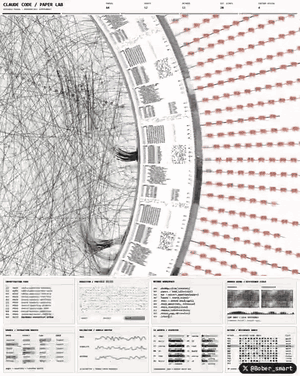
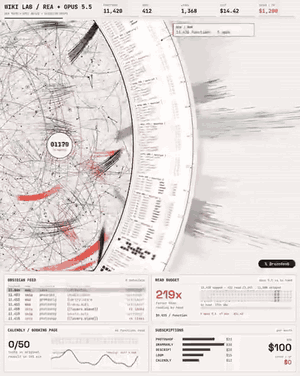
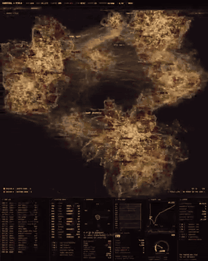
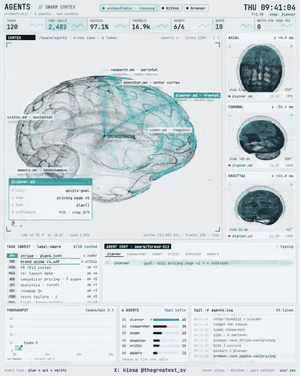

# Inspiration: four instrument videos

The owner's reference videos (`uxinsipirevideos/`, not committed), converted to 6-second GIFs and 12-frame contact sheets with the `video-frames` skill. They define the visual direction in `docs/12-design-guidelines.md`. These are references, not assets: we take ideas and never copy their pixels.

## 1. Paper Lab

[contact sheet](paper-lab-sheet.jpg) · 22 s, 480×600, 60 fps

**What it is.** Header `CLAUDE CODE / PAPER LAB`. A paper-white page dominated by a giant arc that sweeps from the top edge to the bottom. Inside the arc, a ring of tiny dense note cards (text rows, small matrices, pixel blocks) sits on a ruled track with tick marks. Left of the arc, hundreds of black hairline curves cross and bundle into darker cords, like a thread plot of connections. Right of the arc, rows of small vermilion chips march outward on straight radial rays, with black dashes between them. The ring slowly rotates and the camera drifts in, so new note cards slide into view while threads re-route. A small floating formula label appears now and then (`ΣΣ = (w).Δ / Δx`). Under the canvas, an instrument strip of eight panels: investigation feed, a particle solver, network workbench (code-like lines), a heat-map pair, an extraction matrix, validation waveforms, an agent status table, a reference index grid.

**What we take.**
- One huge geometric form (the arc) as the page's spine, with information *on* it rather than in boxes.
- Hairline thread bundles as the picture of evidence and connections.
- Radial rays of small chips as the picture of a queue or a flow of items.
- Paper ground, ink black, exactly one accent (vermilion). Restraint makes the density readable.
- A strip of small, dense instrument panels below the hero, each with a tiny caps title.

## 2. Wiki Lab

[contact sheet](wiki-lab-sheet.jpg) · 20 s, 480×600, 60 fps

**What it is.** Header `WIKI LAB / REA + OPUS 5.5` with five KPI columns (`FUNCTIONS 11,420`, `READ 412`, `LINKS 1,368`, `COST $14.42`, `SAVED / YR $1,200`, the last in vermilion). Left: a circle packed with a dense web of hairlines, heavy black brush-like arcs and a few vermilion strokes, with a round counter badge in the middle that ticks up (`00479 → 10971 FN MAPPED`). The circle's right edge is a thick ruled arc carrying annotated note cards (`note 197 / loom · does: ... · proof: trace#249`) and pixel-block glyph clusters, with tick numbers along the edge. Right: a radial spectrogram of grey and vermilion bars fanning outward. Callout boxes point into the scene (`OBSIDIAN / MEMORY · 412 notes · 1,368 links`). Bottom panels tell a story through numbers that change over the 20 seconds: a feed of mapped functions, `READ BUDGET 219x faster`, `CALENDLY / BOOKING PAGE` tests going `0/50 → 4/50 → 28/50 → 49/50 → 50/50`, and `SUBSCRIPTIONS` falling `$100 → $77 → $39 → $12 → $0` as each tool gets struck through, while `saved / yr` rises to `$1,200`.

**What we take.**
- **Numbers as narrative.** Counters that fill over time tell the story of the work without words. Our version: hypotheses committed, markouts measured, runway days, costs replaced by Jev.
- KPI header row with tiny caps labels over big numerals; one KPI in the accent color.
- Callout boxes with leader lines anchoring explanations onto the visualization.
- Strike-through lines as the picture of a cost being eliminated.

## 3. Survival Field

[contact sheet](survival-field-sheet.jpg) · 15 s, 320×400, 60 fps

**What it is.** Header `SURVIVAL × FIELD` with a status bar: `SEED $50`, `NAV $5,275`, `ELAPSED 48h`, `FLOOR $11`, `LIFE 9/12`, `ROUTES 15`, `OPERATOR asleep`. The main view is a black field of amber particle clouds: several large irregular regions made of hundreds of thousands of glowing points, linked by streams of fine filaments. Each region carries small labels for markets (`doge spot`, `btc basis`, `cats perp`, `heat phoenix`, `rain london`), mixing crypto and weather markets. Legend: `REGION A · CRYPTO BOOK`, `REGION B · WEATHER BOOK`, and `FIELD LIVE · NO HUMAN IN THE LOOP`. The camera drifts and the clouds breathe. Mid-video the whole field shifts to crimson as the equity curve dips (a drawdown, the seed nearly wiped to $11), then cools back to amber as it recovers. Bottom strip: run log, positions book with bars, a hexagonal regime radar (which itself turns crimson), a fill heat panel, an equity curve from $50 to $5,275 with the dip marked, a gauge that swings into red, and a ledger with subscription and inference costs.

**What we take.**
- **The market as a landscape.** Each market or book is a cloud; our positions are the filaments between clouds. This is our home screen.
- **Color is state.** Amber for normal, crimson for stress. The whole field changes temperature with risk, so you feel the drawdown before reading it.
- **The survival HUD.** Seed, NAV, floor, lives, routes and operator status in one line. Our version: NAV, runway, floor (drawdown limit), ladder level, trust streak, counsel queue, operator status.
- Honest captions: "no human in the loop" appears only when it is true.

## 4. Swarm Cortex

[contact sheet](swarm-cortex-sheet.jpg) · 30 s, 480×600, 60 fps

**What it is.** Header `AGENTS // SWARM CORTEX` with KPIs (`TASKS 119 → 149`, `TOOL CALLS 2,456 → 3,178`, `SUCCESS 97.1%`, `TOKENS/S`, `AGENTS 6/6`, `QUEUE`, `WAITS FOR YOUR YES`). The hero is an x-ray point-cloud brain on paper white, teal accents. Each lobe is labeled with an agent file: `planner.md · frontal`, `research.md · parietal`, `executor.md · motor cortex`, `critic.md · occipital`, `coder.md · temporal`, `memory.md · hippocampus`, `ORCHESTRATOR` in the center. When an agent works, its lobe lights teal, fiber tracts glow toward the orchestrator, and a detail card opens (`coder.md · writes code · pricing.tsx · 142 ln · confidence 88% · step 7/9`). Right column: three MRI slice views (axial, coronal, sagittal) of the same brain, updating. Bottom: task ingest list with routing labels, an agent chat thread (planner, researcher, coder, critic, executor, memory, ending in "consensus 6/6 · waits for your yes"), a throughput chart, tool-call bars per agent, and a `tail -f agents.log`. Footer rule: `never ships · deletes · pays without your yes`.

**What we take.**
- **The mind as an organ with regions.** Each lane of our firm is a lobe; work lights the lobe that does it. This is how visitors see our agent roles (docs/18) working.
- Slices as alternate projections of the same state.
- A visible human-approval count (`waits for your yes`) as a first-class number. Ours: the counsel queue.
- Teal accent on paper for the mind; vermilion stays for money.

## Common grammar

Across all four:

1. One dominant form per screen (arc, cloud field, brain), filling the canvas edge to edge.
2. A dense strip of small instruments below it, 6 to 8 panels, each with a caps micro-title.
3. Mono type for labels and data, big tabular numerals for KPIs.
4. Paper or night, never in between, and one accent color per mode.
5. Motion that is slow, continuous and driven by state changes (counters, lit regions, color temperature), never decoration.
6. Captions that state facts plainly (`NO HUMAN IN THE LOOP`, `WAITS FOR YOUR YES`).
